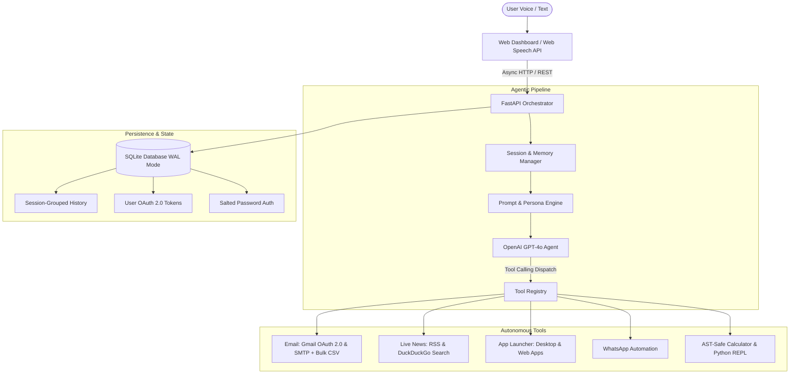

# Nexus AI — Enterprise Voice Assistant & Autonomous Agent

[](https://www.python.org/downloads/)
[](https://fastapi.tiangolo.com)
[](https://platform.openai.com/)
[](https://www.sqlite.org/)
[]()
[](https://opensource.org/licenses/MIT)

An asynchronous, voice-first personal AI assistant and autonomous agent engine. Nexus AI bridges cutting-edge conversational intelligence (ChatGPT/Claude caliber) with real-world OS and web execution: automated Gmail/SMTP email delivery with bulk CSV mailing, Google OAuth 2.0 integration, WhatsApp messaging automation, desktop/browser application control, live multi-topic news search, AST-safe computation, and session-grouped persistent history.

Built for high reliability and zero-latency performance using **Python 3.11+**, **FastAPI**, **SQLite WAL mode**, and a vanilla **HTML5/ES6** responsive dashboard (zero heavy Node.js runtime dependencies).

---

## Key Capabilities & Architecture



### 1. Intelligent Voice Interface & Instant Interruptibility
- **Integrated Microphone Streaming**: Uses the Web Speech API with smooth animated audio level feedback embedded directly within the input field.
- **Instant Audio Interruption**: Floating *"Stop Speaking"* control cancels speech synthesis immediately upon click, keypress (`Escape`), or new input submission.
- **Pure Spoken Delivery**: Output formatting is programmatically stripped of markdown syntax (asterisks, bullet points, headers, backticks), guaranteeing natural and fluid speech synthesis.

### 2. Autonomous Email System & Bulk CSV Dispatch
- **Automated Composition**: Translates user voice intents (e.g. *"Tell Keshav the meeting is moved to Friday 3pm"*) into professional subjects and full greetings/sign-offs using GPT-4o.
- **Multi-Recipient & Bulk CSV Support**:
  - Single recipient delivery.
  - Multi-recipient dispatch with comma and "and" conjunction parsing.
  - Bulk mailing via CSV files (e.g. `contacts.csv`) with automatic header detection (`email`, `name`, `to`) and delivery pacing (0.3s rate limiting).
- **Dual Delivery Modes**:
  - **Google OAuth 2.0 / Gmail REST API (`users.messages.send`)**: 1-click official Google integration sending directly from the user's personal inbox without exposing passwords.
  - **High-Speed Gmail SMTP Fallback**: Dual-port fallback trying SSL port 465 (1.3s latency) and STARTTLS port 587 with dynamic `.env` credential hot-reloading.

### 3. Production Google OAuth 2.0 ("Connect Gmail")
- End-to-end OAuth 2.0 authorization code flow with automatic offline refresh token handling.
- Encrypted SQLite persistence in `user_oauth_tokens` table.
- Live status badge in sidebar UI showing real-time connection status with 1-click connect/disconnect actions.

### 4. Conversational Intelligence & Real-Time News (ChatGPT & Claude Caliber)
- **Deep Explanations & Reasoning**: Comprehensive general knowledge across system design, algorithms, science, mathematics, and philosophy.
- **Multi-Category Live News**: Gathers national, international, technology, and business news via Google News RSS and live search.
- **Proactive Conversational Follow-Up**: Concludes news summaries with proactive prompts (*"Would you like me to dive deeper into any of these stories, or would you like more news on a specific topic like technology, sports, or business?"*).

### 5. Desktop & Web Application Automation (`open_app`)
- **Native OS Launching**: Seamlessly starts native Windows/macOS/Linux utilities (Calculator, Notepad, File Explorer).
- **Web App Direct Navigation**: Direct launcher for YouTube (including specific search/play queries), WhatsApp Web, LinkedIn, Gmail, Spotify, and GitHub.
- **Browser Fallback Engine**: Attempts native executable first, then browser application mode, falling back to system default web browser.

### 6. WhatsApp Messaging Automation (`send_whatsapp_message`)
- Automatic contact name matching and search box navigation.
- Clipboard buffer message insertion to preserve Unicode and emoji formatting without UI blocking.
- Background asynchronous worker thread execution.

### 7. AST-Safe Computation & Sandboxed Python
- Abstract Syntax Tree (AST) safe mathematical evaluation (preventing code injection).
- Isolated Python REPL for running algorithms, data structures, and mathematical computations.

### 8. Session-Grouped History & Security
- Salted SHA-256 password authentication with secure Bearer token sessions.
- SQLite WAL mode (Write-Ahead Logging) with `foreign_keys=ON` and `30.0s` busy timeout.
- Left-sidebar conversation tree grouped by session ID, original query title, turn counter, and relative timestamps.

---

## Directory Structure

```
voice-assistant/
├── agent/
│   ├── main.py              # FastAPI application, REST endpoints, and turn reasoning loop
│   ├── cli.py               # Interactive CLI terminal voice assistant
│   ├── voice.py             # Audio capture, STT transcription, and TTS engine
│   ├── session.py           # Multi-turn conversation buffer with auto-summarization
│   ├── safety.py            # Guardrails, prompt-injection defense, and argument validation
│   ├── prompts.py           # Persona prompt with news follow-up & deep knowledge rules
│   └── tools/
│       ├── email.py         # Gmail REST API (OAuth) + SMTP fallback + Bulk CSV mailing
│       ├── search.py        # Live Google News RSS & DuckDuckGo search
│       ├── launcher.py      # Desktop & web application launcher
│       ├── whatsapp.py      # Automated WhatsApp messaging
│       ├── calc.py          # AST-safe mathematical calculator
│       ├── python_repl.py   # Sandboxed Python execution engine
│       ├── calendar.py      # Calendar event scheduling tools
│       ├── tasks.py         # Task management and tracking
│       └── memory_tools.py  # User fact retention and recall
├── db/
│   ├── schema.sql           # Database schema (users, sessions, chat_history, oauth)
│   └── models.py            # SQLite WAL connection manager and CRUD operations
├── web/
│   ├── index.html           # Modern voice interface with left sidebar and integrated mic
│   ├── app.js               # Web Speech API, session history loader, and speech cancellation
│   └── style.css            # Dark theme responsive design
├── tests/
│   ├── test_agent.py            # Pipeline & tool execution tests
│   ├── test_auth_and_history.py # Auth, health check probes, and session grouping tests
│   ├── test_calc_and_session.py # Math calculator and session buffer tests
│   ├── test_email.py            # Real email, CSV bulk parser, and OAuth delivery tests
│   ├── test_launcher.py         # App launcher and browser fallback tests
│   ├── test_voice.py            # Voice pipeline and audio transcription tests
│   └── test_whatsapp.py         # WhatsApp messaging automation tests
├── Dockerfile               # Multi-stage production container image
├── docker-compose.yml       # Production container orchestration
├── run_server.py            # Production server launcher with dynamic port binding
├── run_voice.py             # Terminal voice assistant launcher
├── requirements.txt         # Production Python dependencies
├── DEPLOYMENT.md            # Cloud deployment guide (Render, Railway, Fly.io, VPS)
└── .env.example             # Documented environment variable template
```

---

## Quickstart Guide

### 1. Installation

```bash
# Clone the repository
git clone https://github.com/your-username/voice-assistant.git
cd voice-assistant

# Create virtual environment
python -m venv .venv

# Activate environment (Windows)
.venv\Scripts\activate
# Or on Linux / macOS:
source .venv/bin/activate

# Install dependencies
pip install -r requirements.txt
```

### 2. Configure Environment

Copy `.env.example` to `.env`:

```bash
cp .env.example .env
```

Configure your credentials in `.env`:

```ini
# OpenAI API Key (Required)
OPENAI_API_KEY=sk-your-openai-api-key
OPENAI_MODEL=gpt-4o

# Server Configuration
PORT=8000
HOST=0.0.0.0

# Email: Gmail SMTP Fallback
SENDER_EMAIL=your-gmail@gmail.com
SENDER_APP_PASSWORD=xxxx xxxx xxxx xxxx

# Email: Google OAuth 2.0 (Optional Production "Connect Gmail" Button)
GOOGLE_CLIENT_ID=your-client-id.apps.googleusercontent.com
GOOGLE_CLIENT_SECRET=your-client-secret
GOOGLE_REDIRECT_URI=http://localhost:8000/api/auth/google/callback
```

### 3. Launch Server

```bash
python run_server.py
```

Navigate to **`http://localhost:8000`** in any web browser.
- Click the microphone inside the input bar to speak.
- Use the **"Stop Speaking"** button to interrupt speech immediately.
- Sign up or log in to manage your conversation history.
- Connect your Google Account with 1-click in the sidebar to enable official Gmail delivery.

---

## Automated Verification & Test Suite

The project includes an extensive test suite covering all tools, authentication, session history, and delivery modes.

```bash
pytest tests/ -v
```

**Results: 64 passed in 26.91s (100% pass rate)**

```
tests/test_agent.py ................                                     [ 25%]
tests/test_auth_and_history.py ..............                            [ 46%]
tests/test_calc_and_session.py ......                                    [ 56%]
tests/test_email.py .................                                    [ 82%]
tests/test_launcher.py ....                                              [ 89%]
tests/test_voice.py ..                                                   [ 92%]
tests/test_whatsapp.py .....                                             [100%]
============================== 64 passed in 26.91s ==============================
```

---

## Production API Reference

| Endpoint | Method | Description |
|---|---|---|
| `/health` | `GET` | Health check probe for Docker / Kubernetes orchestrators |
| `/api/health` | `GET` | Detailed system status (database, AI model connectivity) |
| `/api/chat` | `POST` | Process conversational voice/text turn with tool calling |
| `/api/history` | `GET` | Fetch session-grouped conversation list |
| `/api/history/{id}` | `GET` | Fetch all turns for a specific conversation session |
| `/api/history/{id}` | `DELETE` | Delete a single turn or an entire conversation session |
| `/api/auth/signup` | `POST` | Register a new user account with salted password hashing |
| `/api/auth/login` | `POST` | Authenticate and obtain JWT/session token |
| `/api/auth/logout` | `POST` | Invalidate active session token |
| `/api/auth/google/url` | `GET` | Generate official Google OAuth 2.0 authorization URL |
| `/api/auth/google/callback` | `GET` | Handle Google OAuth code callback & exchange tokens |
| `/api/auth/google/status` | `GET` | Check if user has an active Google OAuth connection |
| `/api/auth/google/disconnect`| `POST` | Disconnect Google OAuth token and revoke access |
| `/api/tts` | `POST` | Synthesize text to speech audio |
| `/` | `GET` | Serve the responsive web dashboard |

---

## Cloud Deployment

### Docker Deployment
```bash
docker-compose up -d --build
```

### Supported Cloud Platforms
Detailed production deployment guides are documented in [DEPLOYMENT.md](DEPLOYMENT.md):
- **Railway**: Automated zero-config deployment from GitHub.
- **Render**: Docker web service deployment.
- **Fly.io**: Global edge deployment with persistent volumes.
- **Linux VPS (Ubuntu/Debian)**: Systemd service with Nginx reverse proxy and Let's Encrypt SSL.

---

## Security & Privacy Highlights

- **Zero Credential Leaks**: `.env` and SQLite database files (`*.db`, `*.db-shm`, `*.db-wal`) are strictly ignored by `.gitignore`.
- **OAuth 2.0 Protocol**: Eliminates the need for end users to provide application passwords in production environments.
- **Input Sanitization**: AST validation prevents command injection during mathematical and code evaluation.
- **Prompt Injection Defense**: Guardrail checks in `agent/safety.py` protect agent reasoning loops.

---

## License

This project is licensed under the [MIT License](LICENSE).
