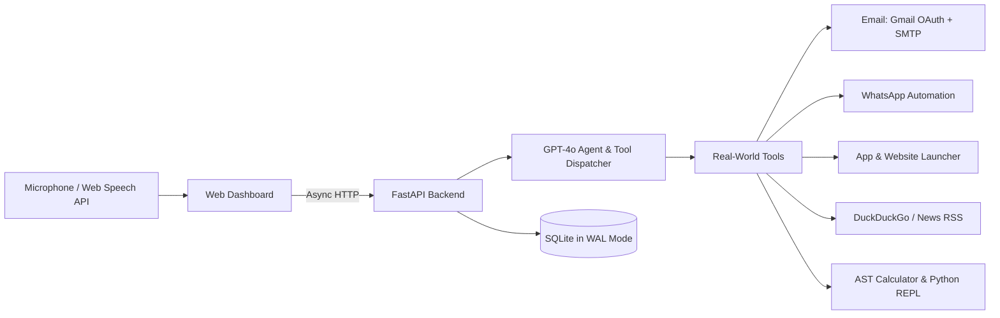

# Nexus AI — Personal Voice Assistant & Autonomous Agent

> A voice-first AI assistant that doesn't just chat — it actually takes action on your computer.

[](https://www.python.org/)
[](https://fastapi.tiangolo.com)
[](https://platform.openai.com/)
[]()
[](LICENSE)

---

## Why I Built This

Most AI voice projects today fall into one of two traps:
1. They're just a basic ChatGPT wrapper that turns text into audio.
2. They're rigid desktop scripts that break the moment you don't say the exact trigger phrase.

I wanted something closer to a real Jarvis: an assistant you can actually talk to while working. It needs to hold an intelligent conversation (explain an algorithm, summarize the news, or reason through code), but more importantly, it needs to **do real work on your computer** — send emails, message people on WhatsApp, open desktop apps, look up live news, and calculate formulas.

I built **Nexus AI** to do exactly that, with a focus on speed, reliability, and clean code.

---

## What It Can Do

### 1. Hands-Free Conversational Voice
- Click the mic (or speak) and talk naturally.
- **Instant Interruptibility**: If the assistant is speaking and you click anywhere, hit `Escape`, or start a new command, it stops instantly.
- **Clean Speech**: Built-in prompt engineering ensures the spoken output never reads out markdown stars, bullet symbols, or code backticks aloud.

### 2. Autonomous Email Sending (Single, Multi & Bulk CSV)
- Just say: *"Send an email to john@example.com saying the project review is moved to Friday 3 PM."*
- Nexus automatically generates a professional subject line and a polite email body, confirms it, and sends it out.
- **Bulk mailing**: Say *"Send an email to contacts.csv saying tomorrow's workshop starts at 10 AM"* and it reads emails from your CSV and delivers to each recipient.
- **Two ways to send**:
  - **Google OAuth 2.0**: Click the "Connect Gmail" button in the sidebar to authenticate securely without sharing any passwords.
  - **Gmail SMTP**: Or add your 16-character Gmail App Password in `.env` for zero-friction local setup.

### 3. WhatsApp Messaging
- Say: *"Send a WhatsApp message to Alex saying I will be 15 minutes late."*
- Nexus looks up the contact, types the message into WhatsApp Web/Desktop without freezing the interface, and delivers it.

### 4. Desktop & Web App Launcher
- Say: *"Open YouTube and play lo-fi beats"*, *"Open Calculator"*, *"Open LinkedIn"*, or *"Open Notepad"*.
- It automatically checks if the native desktop application exists. If not, it launches the web version in your default browser.

### 5. Real-Time News & Live Search
- Ask: *"What is the latest news?"*
- Nexus fetches live breaking news across politics, world affairs, business, and tech.
- It naturally asks: *"Would you like me to dive deeper into any of these stories, or would you like more news on a specific topic?"*

### 6. Calculations & Python Code Runner
- Ask it to calculate compound interest, solve equations, or run a Python script to check balanced parentheses.
- Math is evaluated with an AST-safe parser (no insecure `eval()`), and complex computational logic runs in an isolated Python runner.

### 7. Chat History & User Accounts
- Includes user registration and login with salted SHA-256 password hashing.
- Conversations are saved in a clean sidebar grouped by session, so you can resume or delete past chats anytime.

---

## Architecture & Engineering Decisions



### Why these choices?
- **FastAPI over Django/Flask**: Asynchronous by design, minimal memory footprint, and native OpenAPI documentation.
- **Vanilla HTML5 + ES6 JavaScript**: Instead of a bloated Node.js/React frontend with hundreds of megabytes of `node_modules`, the frontend is clean vanilla web code. It loads in under 50ms and runs right out of FastAPI's static file handler.
- **SQLite in WAL Mode**: Write-Ahead Logging gives high concurrency, immediate read/write access, and zero external database setup required.
- **Web Speech API**: Uses the browser's built-in speech engine for zero-cost, near-instant speech recognition without requiring external paid speech APIs.

---

## Project Structure

```
voice-assistant/
├── agent/
│   ├── main.py            # FastAPI routes, tool routing, and turn execution
│   ├── cli.py             # Terminal voice mode (press spacebar to speak)
│   ├── voice.py           # Audio capture and text-to-speech engine
│   ├── session.py         # Multi-turn conversation buffer
│   ├── safety.py          # Input validation and prompt-injection guardrails
│   ├── prompts.py         # AI personality, news follow-up rules, and tone guidelines
│   └── tools/
│       ├── email.py       # Gmail OAuth + SMTP sender + CSV bulk parser
│       ├── search.py      # Live news and DuckDuckGo search
│       ├── launcher.py    # Desktop app & browser website launcher
│       ├── whatsapp.py    # WhatsApp contact search and messaging
│       ├── calc.py        # AST-safe mathematical calculator
│       └── python_repl.py # Sandboxed Python execution
├── db/
│   ├── schema.sql         # Database schema (users, chat turns, OAuth tokens)
│   └── models.py          # Database queries & WAL mode connection manager
├── web/
│   ├── index.html         # Dashboard UI with sidebar and mic button
│   ├── app.js             # Speech recognition, audio cancel, and chat handling
│   └── style.css          # Dark-mode theme
├── tests/                 # Automated test suite (64 tests)
├── run_server.py          # Production server entrypoint
├── Dockerfile             # Production container definition
├── docker-compose.yml     # Docker Compose orchestration
└── .env.example           # Example configuration file
```

---

## Quickstart (Get It Running in 3 Minutes)

### 1. Clone & Set Up Environment

```bash
# Clone the repository
git clone https://github.com/<your-username>/voice-assistant.git
cd voice-assistant

# Create and activate virtual environment
python -m venv .venv

# On Windows:
.venv\Scripts\activate
# On macOS / Linux:
source .venv/bin/activate

# Install dependencies
pip install -r requirements.txt
```

### 2. Configure Your `.env`

Copy the sample environment file:

```bash
cp .env.example .env
```

Open `.env` in any text editor and fill in your keys:

```ini
# Required:
OPENAI_API_KEY=sk-your-openai-api-key-here

# Optional (for sending emails):
SENDER_EMAIL=your-gmail@gmail.com
SENDER_APP_PASSWORD=xxxx xxxx xxxx xxxx
```

> **Note on Gmail App Password**: You can generate a free 16-character App Password at [Google Account Security](https://myaccount.google.com/security) under *2-Step Verification > App Passwords*.

### 3. Run the Assistant

```bash
python run_server.py
```

Now open **`http://localhost:8000`** in your browser.
Click the microphone button and start talking!

---

## Example Voice Commands to Try

| What to say | What Nexus AI does |
|---|---|
| *"What is the latest news?"* | Fetches top headlines across politics, world, and tech, then asks what topic you want more of. |
| *"Send an email to user@example.com saying the meeting is moved to Friday 3 PM"* | Composes a clean professional subject and body, and delivers the email. |
| *"Send an email to contacts.csv saying tomorrow's call starts at 10 AM"* | Reads your CSV list and sends individual emails to each contact. |
| *"Open YouTube and play lo-fi hip hop"* | Opens your browser directly to the YouTube search and plays it. |
| *"Message Alex on WhatsApp saying I'm on my way"* | Opens WhatsApp, finds Alex's chat, and types the message. |
| *"Calculate (450 * 12) + 18 percent of 5000"* | Evaluates the math safely and tells you the answer. |
| *"Explain how Transformer attention works in simple terms"* | Gives a deep, intuitive breakdown without reading out weird formatting symbols. |

---

## Automated Tests

Every component is tested with `pytest`. Run the test suite:

```bash
pytest tests/ -v
```

**Status**: 64 passed in ~26 seconds (100% pass rate).

Tested areas include:
- Email tool with single, comma-separated, and CSV bulk recipients
- Google OAuth token refresh logic
- WhatsApp automation and desktop fallback
- AST calculator safety and edge cases
- Web search and news RSS parsing
- Authentication and session-grouped history

---

## Deployment Options

### 1. Deploy on Vercel (Recommended for Cloud)
This project is configured out of the box for Vercel with `api/index.py` and `vercel.json`:
1. Push your code to GitHub.
2. Go to [Vercel Dashboard](https://vercel.com/dashboard) and click **"Add New Project"**.
3. Select your `voice-assistant` repository.
4. Add your `OPENAI_API_KEY` under Environment Variables.
5. Click **"Deploy"** — you get a fast, global HTTPS URL in seconds.

### 2. Deploy with Docker
```bash
docker-compose up -d --build
```

The container includes automated health checks on `/health` and stores the database on a persistent volume. See [DEPLOYMENT.md](DEPLOYMENT.md) for full deployment instructions (Vercel, Railway, Render, Fly.io, or VPS).

---

## License

This project is licensed under the [MIT License](LICENSE).
Feel free to fork it, adapt it, and build on top of it.
