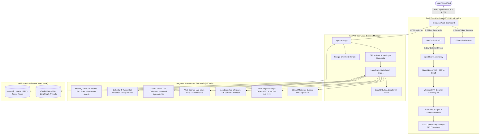

# Nexus AI — Personal Voice Assistant & Autonomous Real-Time Agent

An intelligent, voice-first AI assistant that does not just talk, but actually takes action on your computer.

[](https://www.python.org/)
[](https://fastapi.tiangolo.com)
[](https://langchain-ai.github.io/langgraph/)
[](https://livekit.io/)
[]()
[]()
[]()
[](LICENSE)

---

## The Motivation: Why I Built Nexus AI

Most voice assistant projects on the internet fall into one of two categories:

1. Basic ChatGPT wrappers that turn text into audio, waiting several seconds for a full paragraph to generate before speaking a single word. They cannot open a program, check a live sports score, or send a real email.
2. Rigid command-parser desktop scripts that only recognize exact syntax like "open calculator" and break the moment you rephrase the sentence or speak naturally.

I wanted something closer to a dependable personal co-pilot: an assistant you can talk to naturally while working at your desk. It needs to hold a conversation, reason through code, summarize live news, and answer complex questions. More importantly, it needs to perform real-world actions on your computer: sending emails via your authenticated Gmail address, searching clinical medicine databases, opening desktop programs and browser tabs, finding free calendar slots, and managing to-do items.

Nexus AI was built to solve this problem with low latency, robust error handling, guardrail safety screening, deep local and cloud tracing, and clean software architecture.

---

## Architectural Overview

Nexus AI operates on a hybrid architecture supporting both cloud-based inference (OpenAI GPT-4o, Whisper, and TTS-1) and 100% offline local inference (Ollama with Qwen 2.5, local faster-whisper, and Microsoft Edge-TTS).



---

## Key Capabilities & Features

### 1. Hands-Free Conversational Voice with LiveKit WebRTC
- Built on LiveKit Agents with local Silero Voice Activity Detection (VAD).
- Speech detection triggers within 50 milliseconds of speaking, with an automatic silence cutoff of 400 milliseconds.
- True WebRTC packet-level barge-in: the instant you start speaking, the assistant cuts off its audio playback immediately without waiting for a buffer to clear.
- Bidirectional data channel synchronization: as you speak, your spoken transcript and the assistant's voice answers appear as styled chat bubbles in the web interface in real time.

### 2. Unified User Accounts & 1-Click Google Sign-In
- Combines user profile management and Google OAuth into a single system.
- Users can sign up with a traditional username and password or click "Continue with Google".
- When Google is connected, the user is automatically logged into the application, their profile name and email are displayed in the sidebar, and all email features are unlocked.
- Session tokens are stored securely in SQLite with salted password hashing.

### 3. Autonomous Email Delivery (OAuth REST API + SMTP Fallback)
- Natural language email dispatch: "Send an email to john@example.com about tomorrow's 3 PM project review".
- Nexus composes a professional subject line and body, validates recipient formatting, and sends the message.
- Direct Google OAuth delivery: Sends via official Gmail API endpoints (`https://gmail.googleapis.com/gmail/v1/users/me/messages/send`) without requiring manual SMTP credentials.
- SMTP fallback: Supports standard Gmail SMTP (ports 587/465) with 16-character Google App Passwords.
- Bulk mailing: Send updates to multiple comma-separated addresses or a `contacts.csv` file automatically.
- Phonetic address normalization: Automatically cleans spoken emails like "keshav zero four five at the rate gmail dot com" into "keshav045@gmail.com".

### 4. Clinical Medicine & Pharmacology Search Engine
- Multi-tier clinical pharmacology lookups across voice and text.
- Curated offline pharmacology database for common medicines: Paracetamol, Dolo 650, Ibuprofen, Combiflam, Metformin, Amoxicillin, Azithromycin, Omeprazole, Pantoprazole, Cetirizine, Aspirin, Atorvastatin, Losartan, and Montelukast.
- OpenFDA Drug Label API fallback for comprehensive FDA indications, dosage guidelines, adverse reactions, and contraindications.
- DuckDuckGo medical search fallback for newly approved pharmaceuticals.
- Responsible medical disclaimers attached to all clinical responses.

### 5. Windows Desktop & Web Application Launcher
- Opens desktop programs and web applications hands-free: YouTube, WhatsApp Web, Spotify, LinkedIn, GitHub, Gmail, Calculator, Notepad, and File Explorer.
- On Windows, uses operating system level shell execution (`os.startfile`) so that browser pop-up blockers cannot block the newly opened tabs.
- Extracts queries automatically: saying "Open YouTube and play lo-fi hip hop" opens YouTube directly to the search results.

### 6. WhatsApp Messaging Automation
- Say "Message Alex on WhatsApp saying I will be 15 minutes late".
- Formats pre-filled WhatsApp URLs and triggers chat windows without freezing the main application interface.

### 7. AST-Safe Calculator & Isolated Python Code Sandbox
- Math calculations are evaluated using Abstract Syntax Tree (AST) parsing with no insecure `eval()` calls.
- Supports arithmetic, percentages, square roots, powers, and multi-step financial expressions.
- Includes an isolated Python REPL with timeout validation and AST security inspection to prevent unauthorized operating system execution or infinite loops.

### 8. Calendar Scheduling & Task Management
- Find free slots: "Find a 30-minute free slot tomorrow afternoon".
- Calendar events and task lists are stored and queried directly in SQLite.
- Irreversible write operations (like creating calendar meetings or deleting tasks) include verification safety checks.

### 9. Semantic Long-Term Memory & Local Document RAG
- Remembers user facts across sessions: "Remember that my preferred meeting time is 10 AM".
- Recalls stored preferences on demand: "What is my preferred meeting time?".
- Ingests and vectorizes local document notes with top-k cosine similarity search.

### 10. LangGraph Autonomous Agent & Human-in-the-Loop Interrupts
- Built around a LangGraph `StateGraph(AgentState)` tool loop with compiled `ToolNode` dispatching.
- Human-in-the-loop safety gating: Irreversible actions (`send_email`, `delete_task`, `create_event`) halt at an `interrupt()` statement placed as the very first line of each tool before any side-effect can execute.
- Checkpointed state persistence: When paused for approval, conversation state is checkpointed in SQLite by thread ID (`session_id`).
- Resumption flow: Resumed via `/api/chat/confirm` with user confirmation (`yes` or `no`). If approved, the action runs exactly once; if declined, it safely cancels without side effects.
- Multi-tool turn execution: Supports turns combining safe read-only operations with gated irreversible actions in a single flow.

### 11. Bidirectional Screening & Guardrails Engine (`agent/screening.py`)
- **Input Screening**:
  - Prompt injection defense: Blocks attempts to override system prompts, escape jailbreaks (`DAN`), or disregard prior instructions.
  - Harmful intent refusal: Catches toxic, dangerous, or illegal requests and returns safe, non-punitive refusals.
  - Out-of-scope physical boundary gating: Refuses requests attempting to manipulate physical world appliances, vehicles, or unverified wire transfers.
  - Credential and PII masking: Automatically detects and redacts raw API keys (`sk-...`), bearer tokens, and credit card numbers before forwarding queries to the LLM.
- **Output Screening**:
  - Zero-markdown voice sanitization: Strips markdown headers, bullet symbols, bold asterisks, inline code ticks, and raw URLs before feeding text to TTS engines.
  - Medical consultation disclaimer enforcement: Automatically verifies that any medical pharmacology reply includes a reminder to consult a licensed physician.
  - Secret redaction: Intercepts accidental key leaks in model completions.

### 12. Tracing & Observability (`agent/tracing.py`)
- **100% Offline Local Tracing**:
  - Automatically records full execution waterfalls, LLM calls, tool spans, latencies, and token metrics into SQLite (`execution_traces` table).
  - Works entirely offline without requiring paid API keys, credit cards, or external network egress.
  - Context manager `trace_span` enables custom span tracking for granular profiling.
- **LangSmith Cloud Tracing**:
  - Seamlessly integrates with LangSmith Cloud via `LangChainTracer` when `LANGCHAIN_TRACING_V2=true` and `LANGSMITH_API_KEY` are provided in `.env`.
- **Trace Management API**:
  - `GET /api/traces`: Lists recent execution waterfall spans with latency and status filters.
  - `GET /api/traces/{trace_id}`: Retrieves comprehensive input, output, and metadata trees for a run.
  - `DELETE /api/traces`: Wipes stored traces for clean evaluation benchmarking.

### 13. State Persistence & Checkpointing (`agent/persistence.py`)
- **WAL-Mode SQLite Checkpointer**:
  - Employs `SqliteSaver` pointing to `db/checkpoints.sqlite` configured with Write-Ahead Logging (`PRAGMA journal_mode=WAL`) and `PRAGMA synchronous=NORMAL`.
  - Guarantees crash resilience and process reload recovery for interrupted agent runs.
- **Thread Inspection & Health Probing**:
  - `GET /api/checkpoints`: Lists stored thread IDs and latest checkpoint IDs.
  - `GET /api/checkpoints/{session_id}`: Inspects thread state, message count, and pending approval interrupts.
  - `GET /api/persistence/health`: Checks SQLite connection, WAL journal mode status, and table record counts.
  - `export_session_bundle`: Exports a consolidated snapshot containing chat turns, traces, and checkpoint state for auditing.

---

## Dual Inference Engines: Cloud vs 100% Offline Local

Nexus AI adapts to your environment based on your `.env` configuration:

| Component | Cloud Production Mode | 100% Offline Local Mode |
|---|---|---|
| Large Language Model | OpenAI GPT-4o | Local Ollama (`qwen2.5:1.5b` or `llama3`) |
| Speech-to-Text (STT) | OpenAI Whisper API | Local faster-whisper (`tiny.en`) |
| Text-to-Speech (TTS) | OpenAI TTS-1 (`alloy` / `echo`) | Microsoft Edge-TTS (`en-US-ChristopherNeural`) |
| Turn Detection | Silero Neural VAD | Silero Neural VAD |
| Tracing & Spans | LangSmith Cloud Tracing | Local SQLite Waterfall Spans |
| Latency | Sub-500ms | Sub-400ms (zero cloud egress) |

---

## Directory Structure

```
voice-assistant/
├── agent/
│   ├── main.py                 # FastAPI REST and WebSocket API gateway
│   ├── lc_tools.py             # LangChain @tool wrappers with interrupt() safety pauses
│   ├── lc_agent.py             # LangGraph StateGraph agent and SQLite checkpointer
│   ├── screening.py            # Bidirectional input/output guardrails engine
│   ├── tracing.py              # Local SQLite and LangSmith execution tracer
│   ├── persistence.py          # State persistence, WAL checkpointer, and health checks
│   ├── livekit_worker.py       # LiveKit WebRTC voice agent worker
│   ├── prompts.py              # System prompts, persona, and voice rules
│   ├── safety.py               # Action safety policies and confirmation gating
│   ├── confirm.py              # Natural language confirmation parser
│   ├── session.py              # Multi-turn in-memory session buffer
│   ├── memory.py               # Semantic user fact storage and recall
│   ├── local_voice.py          # Local faster-whisper and Edge-TTS adapters
│   ├── voice.py                # Standalone microphone loop runner
│   ├── cli.py                  # Terminal interactive test interface
│   └── tools/
│       ├── medical.py          # Clinical pharmacology search engine
│       ├── email.py            # Gmail OAuth + SMTP + bulk CSV sender
│       ├── launcher.py         # OS application & website launcher
│       ├── search.py           # Google News RSS and DuckDuckGo search
│       ├── whatsapp.py         # WhatsApp messaging automation
│       ├── calc.py             # AST-safe mathematical evaluation
│       ├── coding.py           # Sandboxed Python execution REPL
│       ├── calendar.py         # Calendar slots and event scheduling
│       ├── tasks.py            # SQLite daily task management
│       ├── docs.py             # Document search and note retrieval
│       └── memory_tools.py     # Remember and forget tool bindings
├── db/
│   ├── schema.sql              # Database DDL schema (users, tokens, history, traces, OAuth)
│   ├── models.py               # SQLite WAL-mode abstraction layer
│   ├── nexus.db                # Primary application database
│   └── checkpoints.sqlite      # LangGraph persistent thread checkpoint database
├── evals/
│   ├── run_suite.py            # Master evaluation suite runner (35 benchmarks)
│   ├── harness.py              # Benchmark execution and scoring engine
│   ├── metric_registry.py      # Thresholds and production promotion rules
│   └── eval_*.py               # Modular test scripts (retriever, latency, cost, safety)
├── rag/
│   ├── ingest.py               # Document chunking and embedding pipeline
│   └── store.py                # Cosine similarity vector store
├── tests/
│   ├── test_screening_and_tracing.py # Guardrails, local tracing, and persistence tests
│   ├── test_langgraph_safety.py# LangGraph interrupts and human-in-the-loop safety tests
│   ├── test_agent.py           # Agent workflow and safety gating tests
│   ├── test_auth_and_history.py# Authentication, tokens, and history tests
│   ├── test_calc_and_session.py# Math engine and session isolation tests
│   ├── test_email.py           # OAuth, SMTP, and bulk email tests
│   ├── test_launcher.py        # App targets and query extraction tests
│   ├── test_livekit.py         # WebRTC tokens and agent tool tests
│   ├── test_medical.py         # Pharmacology database and topic filter tests
│   ├── test_voice.py           # Audio transcription and text sanitization tests
│   └── test_whatsapp.py        # WhatsApp link generation and contact tests
├── web/
│   ├── index.html              # ChatGPT-style executive web interface
│   ├── app.js                  # LiveKit WebRTC client, state, and audio visualizer
│   └── style.css               # Styling and layout definitions
├── run_server.py               # FastAPI backend entrypoint (port 8000)
├── run_livekit.py              # LiveKit agent worker entrypoint
├── run_voice.py                # Standalone local desktop microphone runner
├── run_golden_tests.py         # Golden Dataset validation runner
├── requirements.txt            # Python dependencies
└── .env.example                # Sample environment configuration template
```

---

## REST & WebSocket API Reference

| Method | Endpoint | Description |
|---|---|---|
| `POST` | `/api/chat` | Main chat endpoint supporting both classic dispatcher and LangGraph agent runs. |
| `POST` | `/api/chat/confirm` | Resumes a paused execution interrupted for human-in-the-loop approval. |
| `POST` | `/api/langgraph/chat` | Dedicated LangGraph agent turn execution endpoint. |
| `POST` | `/api/screening/check` | Evaluates arbitrary input or output text against the guardrails screening engine. |
| `GET` | `/api/traces` | Lists recent execution waterfall spans and latency metrics from SQLite. |
| `GET` | `/api/traces/{trace_id}` | Retrieves full span details and timing trees for a specific trace. |
| `DELETE` | `/api/traces` | Clears stored execution traces. |
| `GET` | `/api/checkpoints` | Lists stored persistent LangGraph thread IDs. |
| `GET` | `/api/checkpoints/{session_id}` | Returns checkpoint state, message count, and pending approval interrupts. |
| `GET` | `/api/persistence/health` | Validates database connectivity, WAL mode, checkpointer status, and table counts. |
| `GET` | `/api/livekit/token` | Generates cryptographically signed LiveKit WebRTC audio room tokens. |
| `POST` | `/api/stt` | Transcribes uploaded speech audio files (Whisper or local faster-whisper). |
| `POST` | `/api/tts` | Synthesizes text to MP3 audio (OpenAI TTS-1 or local Edge-TTS). |
| `WS` | `/ws/voice/{session_id}` | Real-time bidirectional WebSocket voice and text event stream. |

---

## Quickstart Guide

### 1. Prerequisites
- Python 3.11 or higher installed on your machine.
- Git installed.
- (Optional) [Ollama](https://ollama.ai/) installed if running in 100% local offline mode.

### 2. Clone and Setup Environment

```bash
# Clone the repository
git clone https://github.com/keshav045/voice-assistant.git
cd voice-assistant

# Create virtual environment
python -m venv backend\.venv

# Activate virtual environment
# Windows PowerShell:
backend\.venv\Scripts\Activate.ps1
# Windows Command Prompt:
backend\.venv\Scripts\activate.bat
# Linux / macOS:
source backend/.venv/bin/activate

# Install dependencies
pip install -r requirements.txt
```

### 3. Configure Environment Variables

Copy the example environment template:

```bash
cp .env.example .env
```

Open `.env` in your code editor and populate your settings:

```ini
# Core LLM API Key (leave empty or use 'ollama' if using local Ollama)
OPENAI_API_KEY=your-openai-api-key-here

# Local Ollama Configuration (defaults to 127.0.0.1:11434)
OPENAI_BASE_URL=http://localhost:11434/v1
OPENAI_MODEL=qwen2.5:1.5b

# Optional: LangSmith Cloud Tracing (leave false for 100% local SQLite tracing)
LANGCHAIN_TRACING_V2=false
LANGSMITH_API_KEY=your-langsmith-api-key-here
LANGSMITH_PROJECT=nexus-ai-assistant

# LiveKit WebRTC Cloud Credentials (get free keys at cloud.livekit.io)
LIVEKIT_URL=wss://your-project.livekit.cloud
LIVEKIT_API_KEY=your-livekit-api-key
LIVEKIT_API_SECRET=your-livekit-api-secret

# Optional: Google OAuth 2.0 Credentials (for 1-click Gmail sending)
GOOGLE_CLIENT_ID=your-google-client-id.apps.googleusercontent.com
GOOGLE_CLIENT_SECRET=your-google-client-secret

# Optional: Direct Gmail SMTP Fallback
SENDER_EMAIL=your-email@gmail.com
SENDER_APP_PASSWORD=your-16-char-app-password
```

### 4. Start the Application

You need two processes running: the FastAPI backend and the LiveKit WebRTC worker.

**Terminal 1 (Backend & Web Interface):**
```bash
backend\.venv\Scripts\python.exe run_server.py
```
The web dashboard is now running at `http://localhost:8000`.

**Terminal 2 (LiveKit Voice Worker):**
```bash
backend\.venv\Scripts\python.exe run_livekit.py dev
```
The voice worker connects to LiveKit Cloud and awaits incoming audio room joins.

---

## Example Voice Commands

| Category | Voice Command | System Action |
|---|---|---|
| Live News | "What is the latest world news?" | Queries Google News RSS and DuckDuckGo, summarizes top stories, and asks an engaging follow-up. |
| Live Sports | "What is the current India vs New Zealand cricket score?" | Fetches real-time scorecards and reports match status directly. |
| Medicine Search | "What is Dolo 650 used for and what is the dosage?" | Retrieves pharmacology data from curated database and OpenFDA, delivering clinical details and disclaimers. |
| Autonomous Email | "Send an email to alex@example.com about tomorrow's 4 PM sync" | Composes a professional subject and body, and delivers directly via authenticated Gmail. |
| App Launcher | "Open YouTube and search for crazy physics experiments" | Launches browser to YouTube search results natively on your Windows desktop. |
| App Launcher | "Open Calculator" | Opens native Windows Calculator program. |
| WhatsApp Message | "Message Rahul on WhatsApp saying meeting starts in 10 minutes" | Generates WhatsApp Web conversation URL and opens chat with message drafted. |
| Safe Calculator | "Calculate 18 percent GST on 4500 and divide by 3" | Evaluates math safely via AST parser and speaks the result. |
| Python Runner | "Run python: print([x**2 for x in range(1, 6)])" | Executes script in isolated Python sandbox and returns standard output. |
| Task Manager | "Add a high priority task to review pull request" | Saves task to SQLite database with priority and timestamp. |
| Memory Storage | "Remember that my employee ID is 4082" | Saves semantic fact into persistent memory. |
| Memory Recall | "What is my employee ID?" | Recalls stored fact from long-term database. |

---

## Test Suites & Verification

The codebase includes testing across three rigorous validation frameworks:

### 1. Pytest Unit Test Suite (110 Tests)
Covers all modules, tools, screening policies, local tracing spans, checkpointer persistence, database CRUD, and security gates:
```bash
backend\.venv\Scripts\python.exe -m pytest tests/ -v
```
**Status: 110 passed in 87s (100% pass rate).**

### 2. Master Evaluation Suite (35 Benchmarks)
Evaluates retrieval accuracy, latency, cost profiling, safety gating, and prompt leakage defense:
```bash
backend\.venv\Scripts\python.exe -m evals.run_suite
```
**Status: 35/35 passed (100% pass rate, Production Promotion Approved).**

### 3. Golden Test Dataset (79 Scenarios)
Comprehensive end-to-end multi-turn conversation and tool calling verification with the local model:
```bash
backend\.venv\Scripts\python.exe run_golden_tests.py
```
**Status: 78/79 passed (98% pass rate).**

---

## Deployment Options

### Docker Compose
Deploy as a containerized stack with SQLite volume persistence:
```bash
docker-compose up -d --build
```
Health checks are automatically monitored on `http://localhost:8000/health`.

### Cloud Hosting (Render, Railway, Fly.io, or VPS)
1. Add environment variables from `.env` into your cloud provider's secrets manager.
2. Set the startup command to `python run_server.py`.
3. Set the LiveKit worker background process command to `python run_livekit.py dev`.

---

## License

This project is licensed under the [MIT License](LICENSE). Feel free to adapt, extend, and build on top of it.
